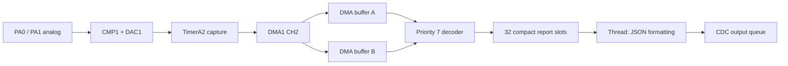

# Interrupt-rearmed PD reception

The receiver uses the native design's core principle: two DMA buffers of 860
halfword intervals. Packet-gap IRQ processing rearms the alternate buffer before
waking an independent decoder. It does not wait for USB or the UI.



## Ownership and scheduling

Each DMA slot has FREE/FILLING/READY/READING state. A completion can publish its
slot only if the other is FREE and can immediately accept the next burst.
Otherwise it discards the newly completed burst, increments `overruns`, and
reuses that same slot. Neither unread READY data nor a borrowed READING slice
is overwritten. Host tests cover an indefinitely stalled reader and repeated
alternation. A frame guard ties a read slice to the receiver's lifetime and
releases its slot on drop. Static backing memory outlives all DMA access.

The timer/DMA handlers (priority 5) stop event producers, quiesce DMA, compare
MONDTCTL2 against DCU count, publish metadata, and rearm. Interrupts do not copy,
decode or format the burst. A failure to quiesce is reported and prevents exposing
a still-writing buffer. Burst-full, DMA errors and count mismatch are separate
conditions. Fewer than 20 captured events are counted as noise and rearmed without
occupying the decoder, matching the native short-burst filter.

An Embassy interrupt executor on INT030 runs the decoder at priority 7. It can
preempt USB (priority 8) and the thread executor's display/measurement work.
INT030 is unmapped from hardware events and is pended only by Embassy. Before
BMC/CRC work, the decoder copies the completed intervals to a private staging
array and releases the DMA slot. That staging array is not a third DMA target.

Decoded packet/reset records enter a bounded 32-slot typed queue. A thread task
formats JSON and submits it to the existing CDC queue. Both queues count output
loss rather than blocking acquisition. Full raw interval uploads remain an
explicit single-burst diagnostic mode; continuous mode emits decoded records.

The retained logger also matters to IRQ latency. It now computes/reserves a
record span without formatting under an interrupt mask, then masks only a
cursor check and single-byte store at a time. Nested writes reserve separate
spans; an old writer skips storage that has already wrapped out of the ring.
As before, reset can leave an incomplete diagnostic record. Trace formatting
must not delay packet-gap IRQs for the duration of an entire USB log message.

## Commands and diagnostics

- `pd start 1` / `pd start 2`: continuous passive receive on CMP input 1/2.
- `pd start auto`: use the [line ADC](line-adc.md) to follow the active CC.
- `pd stop`: stop acquisition and report counters.
- `pd 1` / `pd 2`: retain the older single-burst/raw diagnostic interface.

```sh
cargo build --release --locked \
  --features cdc-telemetry,pd-capture,orientation,manual-ui-test
uv run tools/usb_telemetry.py --seconds 40 --pd 1 --pd-continuous \
  --output capture.ndjson
```

`pd_stats` reports completed frames, overruns, overruns while a slot was borrowed,
short/noise bursts, full buffers, DMA errors, DCU/DMA mismatches, quiescence faults
and maximum handler/rearm cycles. `decode_errors` counts failures after SOP;
`sync_errors` counts rejected intervals while searching for SOP. Sync rejection
can coexist with a later CRC-valid packet and is not itself a lost-packet count.
Output drops are reported separately by the ADC telemetry `dropped` field.

`pd_packet.end_us` is IRQ-observed packet-end uptime from the current Embassy
clock, whose resolution here is 1 ms despite the field's microsecond units. It
is not a precise wire timestamp. `max_handler_cycles` measures work after handler
entry with DWT, not interrupt latency before entry. At HCLK 192 MHz, divide cycles
by 192 for microseconds. Interval capture itself runs at PCLK1/8 = 12 MHz.

This is bounded buffering, not a guarantee of lossless capture under arbitrary
traffic or host stalls. The source can outrun any finite queue; physical loss
while IRQs cannot run may not be fully detectable from counters. PA0/CMP1_INP1
has been accepted for the present cable orientation. The other orientation and
complete analog CC schematic remain separate work. No transmitter, termination
switching or GoodCRC generation is enabled.

[Hardware evidence](../hardware/pd-buffered/README.md) distinguishes the initial
implementations with loss from the accepted build and host-backpressure test.
