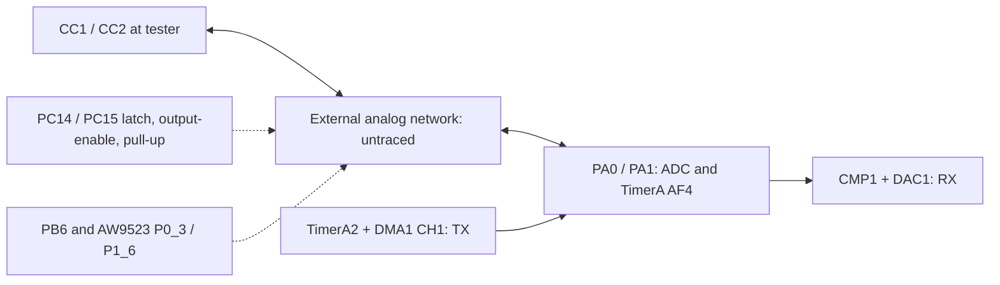

# PD transmission and usbpd integration

The installed HW2.1 **stock 2.0.7** image is the primary source for this analysis,
updated 2026-10-29. Its software encodes PD frames, uses TimerA2/DMA1 to produce
BMC transitions, and uses CMP1/DAC1/timer capture for RX. No dedicated HC32 PD
peripheral or automatic hardware GoodCRC engine has been identified. The USB FS
PHY on PA11/PA12 is a separate peripheral.

The firmware runs the crates.io `usbpd` 2.0.0 sink stack with software GoodCRC,
message IDs, retries and Request/Accept/PS_RDY negotiation. Fixed
5/9/12/15/20 V contracts were accepted on CC1 with an unloaded charger, and CC2
also negotiated 20 V. ADC selects the detached line; the stack is recreated
after a cable flip. [CC2 acceptance](../hardware/cc2/README.md) preserves those
measurements. PPS and EPR policy remain unimplemented.

Use `bash tools/rpc.sh sink 20` for an explicit unloaded-charger session, or
`bash tools/rpc.sh monitor auto` for passive reception. Acquisition and active
PD both use the RPC owner; passive reception never enables Rd or sends GoodCRC.
[RPC documentation](rpc.md) describes commands, topics and scheduling.

The original fixed Get_Source_Capabilities probe, CDC commands and standalone
benchmark programs have been removed. Historical captures below establish the
hardware behavior; commands in archived hardware records describe those versions.

## Verified 2.0.7 code

[Address mapping](../analysis/pd207/address-map.json) preserves the catalog 1.9.9
and installed 2.0.7 locations. These are runtime addresses. The newer control
flow and register operations were checked; matching a short byte prefix alone
was insufficient to establish a function identity.

| 2.0.7 address | Function |
| --- | --- |
| `0x9268` | Create `PD_PHY` task and initialize hardware |
| `0x934e` | Alternate RX buffers and rearm capture |
| `0x9430` | Encode a frame, switch to TX, wait and return to RX |
| `0xf86e` / `0xf976` | Select CMP input / PA0 or PA1 AF4 output |
| `0xfa8c` | Load first period and start DMA1 CH1 / TimerA2 |
| `0xfb10` | TX DMA completion: disable CH1, hold output, arm overflow IRQ |
| `0xfb46` | Select RX or TX hardware mode and overflow callback |
| `0xfbde` | Initialize timer, comparator, DAC, DMA and IRQ routing |
| `0xfff2` | Final TX timer overflow: stop timer and signal completion |
| `0x1ed58` | PHY task: decode RX, construct GoodCRC and dispatch TX/reset |
| `0x1fff8184` | RAM-resident packet-to-period encoder |

The native RX buffers are at `0x200111e8` and `0x20012866`, with **2860** halfword
intervals per capture (`0xb2c`) and metadata at byte offset `0x1658`. The older
catalog used 860. Our accepted receiver still uses 860; that covers the tested
ordinary/chunked frames and does not claim support for arbitrary long frames.

[Native C/assembly exports and provenance](../analysis/pd207/README.md) distinguish
instruction evidence from inferred decompiler types and signatures.

## TX, completion and errors

The 2.0.7 sequence is:

1. Check the object's TX-enable flag; otherwise return status 10.
2. Check CMP1 output for carrier availability (or bypass in native mode 5).
   The busy path retries three times with a delay-helper argument of 10; it
   returns status 9 if the line never becomes available. Delay units were not
   established by this analysis.
3. Encode into the current native DMA-buffer storage using the RAM encoder.
4. Disable ADC1 analog watchdog through `0x52c0(0)`.
5. Switch to TX: mask CMP edge events, stop RX timer start conditions, set
   selected PCONR.PERC=3 (invert at period), enable OUTEN and clear TX CHEN.
6. Drive selected PC14/PC15 low with its output enabled, through `0x40958`.
7. Preload PERAR=`buffer[0]`, SAR1=`buffer+1`, DMA count=`count-1`; start CH1 and
   TimerA2. Timer overflow event `0x103` supplies each following PERAR value.
8. DMA completion runs `0xfb10`: disable CH1, set PERC=2 (**hold**, not low), and
   enable the timer overflow interrupt. The last loaded interval still has to
   elapse. The vendor DDL calls these output modes `TMRA_PWM_INVT` and
   `TMRA_PWM_HOLD`.
9. The final overflow runs `0xfff2`, stops TimerA2 and signals the PHY event.
10. The waiting TX function disables timer OUTEN (`0xf9c4`), disables the selected
    PC14/PC15 output (`0x4093e`), rearms RX and enables the ADC watchdog again.

The event wait has timeout argument 5. On a nonzero wait result, status 9 is
returned, but the same output-disable/RX-rearm path still runs. The unit of this
RTOS argument is not assumed here. This caller does not explicitly quiesce TX
DMA on its timeout branch; normal DMA completion does disable it. That is not a
proof that DMA is settled after every abnormal exit.

A Rust driver must therefore wait for **wire completion**, not just DMA-done,
and must stop event producers and settle both DMA channels before recycling
memory on cancellation/failure. A dedicated TX buffer avoids the native shared
RX/TX storage arrangement. The current application owns ADC1 separately and
leaves its watchdog off: it must not blindly copy the stock unconditional
watchdog re-enable.

## Electrical controls and what remains unknown

Hardware tests establish PA0/CMP1_INP1 as CC1 and PA1/CMP1_INP2 as CC2 on this
unit. GPIO functions below are verified software controls. The diagram's analog
block is intentionally unresolved; it is not a traced schematic.



| 2.0.7 helper | Verified action |
| --- | --- |
| `0x4093e(selector)` | Disable PC14/PC15 output for selector 1/2 |
| `0x40958(selector)` | Selected PC14/PC15 latch low, output enabled |
| `0x40980(selector)` | Selected PC14/PC15 latch high, output enabled |
| `0x409a6()` | Release P0_3, set P1_6 latch high, disable both PC outputs |
| `0x40a78()` | Clear PC14/15 DDIS and output-enable; enable PB6 output |
| `0x40ab0(selector)` | Select PA0/1 AF4 and matching comparator input |
| `0x40ae0(selector)` | 1: PB6 low; 2: P0_3 high-Z; other: both |
| `0x40b12(mode)` | 0: PB6 low + P0_3 high-Z; 1: PB6 high; 2: P0_3 low; 3: PB6 high + P0_3 low |
| `0x40b58(mode)` | PC14/PC15 pull-ups: 0=off/off, 1=on/off, 2=off/on, 3=on/on |

AW9523 helper `0x1a5ae(mask,state)` changes OUTPUT0 and CONFIG0. State 0 sets the
configuration bit (input/high-Z), state 1 latches high then enables output,
other states latch low then enable output. Mask `0x08` is P0_3. `0x1a63c` changes
OUTPUT1 only: state 1 high, others low; mask `0x40` is P1_6. Its direction is not
set by that helper.

Composite helper `0x409c8(1)` enables PC14 pull-up, drives PC15 high/enabled,
latches P0_3 high/enabled **and sets PB6 high**. The older corresponding helper
lacked that PB6 write. For selector 2, it enables PC15 pull-up, drives PC14
high/enabled, latches P1_6 low and P0_3 low/enabled. These sequences are why
PC14/PC15 cannot be treated as simple independent TX-enable pins.

The firmware and CC1 probe establish that these signals participate in CC
attachment/role and transmit behavior. PB6 high has now enabled sink attachment
on CC1 with an unloaded charger. This does not prove transistor topology,
resistor values, active polarity at a hidden switch, direct CC continuity,
VCONN routing, or the
physical implementation of the lightning button's startup pulldown. Labeling
PC14/15 pull-ups as confirmed Rp resistors would still go beyond this evidence.
P0_3 low/output has now enabled CC2 sink attachment and 20 V negotiation on this
unit; release uses CONFIG0 input/high-Z, with register readback. This establishes
its role as the CC2 Rd control, without identifying the external transistor or
resistor network. Continuity/component tracing
and analog level/impedance measurements remain necessary to finish the schematic.

## Encoding verified without the device

`pd::tx::encode` is allocation-free and writes only a caller-provided RAM slice.
It produces the native preamble, all five SOP ordered sets, low/high-nibble
4b5b data, reflected CRC-32 in wire order, EOP, and native even-halfword padding.
Hard/Cable Reset use their native shorter path without data CRC/EOP.
Length/timing/capacity failures leave output untouched. Wire chunks are limited
to a two-byte header plus up to seven four-byte data objects.

The stock RAM encoder was recovered by executing its actual scatter-load and
decompression stage in Unicorn, stopping before main. Its native CRC32 init
sets `0x40008c00=0x1e`; CRC MMIO was modeled with independent zlib CRC32. Timer,
DMA, analog circuitry, interrupts and electrical response times were not modeled.
The Rust encoder matches **162 full native reload vectors**: all SOP variants,
0..7 data objects, four payload patterns, and both reset ordered sets. The
independent RX decoder also recovers each packet/reset with CRC checks.

Native reloads are 19 and 38 at the current timer setup; these are PERAR values,
not a measurement of edge-to-edge timing. Inclusive up-counting and live reload
behavior must be accounted for and checked electrically before TX acceptance.
Matching the waveform words does not establish amplitude, impedance or timing
on CC.

## Running the usbpd sink

`usbpd` **2.0.0 from crates.io** is an optional `km003c-drivers` dependency.
The offline `pd_decode` example uses it with `--features usbpd` for SOP semantic
parsing; cable-addressed SOP′/SOP″ traffic is kept distinct. This already builds
for the HC32 target as well as the host. No git fork or main dependency is used.

The board implements `usbpd_traits::Driver` with
`HAS_AUTO_GOOD_CRC=false` and `HAS_AUTO_RETRY=false`. Native task `0x1ed58` also
constructs a two-byte GoodCRC in software, then calls the normal TX function;
this is conditional on the native mode/state flags. It is not evidence of
automatic hardware acknowledgement, or a reason to acknowledge packets while
operating as a passive monitor.

The adapter uses these ownership boundaries:

- One owner for the RX/TX timer, CMP/DAC, DMA1 CH1/2, mux and frame buffers.
- `receive`: delivers only CRC-valid SOP header/data bytes, excluding PHY framing
  and CRC; surfaces Hard Reset. Cable traffic stays in diagnostics separately.
- `transmit`: encodes into permanently owned TX storage, checks carrier, switches
  RX→TX, awaits final timer completion, releases outputs and restores RX. DMA
  must settle before memory reuse, including cancellation/error paths.
- Fast receive/protocol work runs outside thread-mode UI/JSON formatting. Software
  GoodCRC must not depend on USB queues or the 20 ms ADC polling interval.
- `wait_for_vbus` uses the INA229 measurement, while CC attach/termination policy
  is separately owned. Automatic receiver mux changes must not race a TX frame.
- An explicit DPM selects an advertised fixed PDO at 100 mA, falling back to
  5 V when unavailable. It does not use the crate's highest-current default.

```sh
cargo build --release --locked
bash tools/rpc.sh sink 20
```

RPC accepts a `Sink` request with a fixed voltage and duration in seconds
(1..600). The selected input/PWM/gate stay locked while attached. A stable
physical disconnect ends that attachment, releases both Rd paths and permits
ADC to select the next line. Each attachment starts fresh protocol state; the
overall session deadline remains in force. No session starts at USB enumeration.

CC1 Rd uses PB6 high; release drives it low. CC2 uses AW9523 P0_3: first latch
low, then enable GPIO output; release selects input/high-Z. P1_6 stays unchanged.
The expander and accelerometer share Embassy's async `I2cDevice` bus adapter.
A separate expander mutex protects complete read-modify-write sequences against
panel reset/backlight changes. A worker owns CC2 updates even if its caller is
cancelled. Normal stop and `loader` await confirmed high-Z before reporting
detach/reset; failures are reported rather than treated as a detach. Fault
handlers stop direct TX immediately but cannot perform async I2C, so external
CC2 Rd release cannot be guaranteed during a panic or a persistent bus failure.

The independent CC lease expires ten seconds beyond the requested session
duration. It queues expander release in addition to
stopping direct outputs. These are task-driven bench bounds, not a complete
Type-C connection manager or a hardware watchdog. `pd stop`, Exit and `loader`
retain recovery behavior. ## Timing and profiling

The [TimerA1 HAL backend](time-driver.md) supplies 32,768 logical ticks/s using
free-running counter/compare alarms. The former DWT-based one-millisecond
CRCReceive poll is removed. The stack timer adapter awaits an ordinary Embassy
Timer with `Duration::from_millis(ms) + Duration::from_ticks(1)`. The extra tick
covers the rounded-down start timestamp; the hardware test measured the padded
1 ms wait at 1.019..1.054 ms across varied start phases. Other Embassy tasks can
run while the deadline is pending. SysTick and automatic DFU reset are removed.

`DEMCR.TRCENA` and `DWT_CTRL.CYCCNTENA` enable profiling. `end_cycles` is recorded
when the RX IRQ ends a frame; `rx_to_tx_cycles` stops immediately before starting
the TX timer. Use wrapping subtraction and divide cycles by 192 for nominal µs.
The RX mark follows the approximately 12.75 µs quiet gap, so this is not itself
an external EOP timestamp. Captures preserve cycle counts and `end_us`, whose
clock now has approximately 30.5 µs resolution despite its microsecond units.

The completed-burst decoder keeps symbol state in local variables; the separate
streaming decoder remains available. It validates CRC before delivery and is
cross-checked against all 162 native vectors and a captured Pixel Request.
Its hot loop runs in zero-wait SRAMH. Startup follows DDL 3.3.0's 200 MHz example:
SRAMH zero waits, SRAM12/3/R one wait, flash five waits with cache. Linker symbols
and a build assertion protect cortex-m-rt's normal data-copy boundary.

`decode_phase_cycles` contains ordered-set search, payload BMC/4b5b plus shape
validation, CRC and packet assembly/return times. With the selected scalar
Thumb-2 decoder, six-PDO Source Capabilities measured about
10.2 / 28.9 / 2.6 / 1.8 µs respectively, with about 49.8 µs in the instrumented
driver path. GoodCRC TX starts about 102..104 µs after the RX mark (about
115..117 µs including the quiet gap), below the 195 µs tTransmit limit in these
runs. The preceding portable burst implementation measured about 74 µs and
127 µs respectively; its evidence remains in `hardware/pd-sink`.
This is software
instrumentation, not an electrical compliance measurement. See the
[onsemi timing table](https://www.onsemi.com/pdf/datasheet/fusb302b-d.pdf), page 16;
that page was extracted using the user's `mistral_ocr --pages 16` CLI.

The [decoder comparison](pd-decoder.md) measured 18 complete implementations,
including two-lane `UQSUB16` and four-lane `UQSUB8`/`USUB8` kernels. Packing,
classification and dispatch outweighed their SIMD benefit on these fixtures.
The accepted path uses scalar Thumb-2, unrolled BMC/4b5b and confirmed alternating
preamble skipping. Five runs of 128 measurements each reduced Source
Capabilities from 73.36 to 45.17 µs (complete decode, CRC included, profiling
disabled). [New evidence](../hardware/pd-optimization/README.md) also records
renewed 5/9/12/15/20 V contracts and preserved recovery for that image. The
subsequent [time-driver acceptance](../hardware/time-driver/README.md) records
renewed contracts after replacing the clock backend.

Sources: [published driver contract](https://docs.rs/usbpd-traits/2.0.0/usbpd_traits/trait.Driver.html),
[published sink policy](https://docs.rs/usbpd/2.0.0/usbpd/sink/device_policy_manager/trait.DevicePolicyManager.html),
[upstream repository](https://github.com/elagil/usbpd). Upstream main was checked
at `b21607ad8b960da56ae801c5e42d9a86485a1f81`; its package declares 3.0.0, but
this integration deliberately uses the published 2.0.0.
