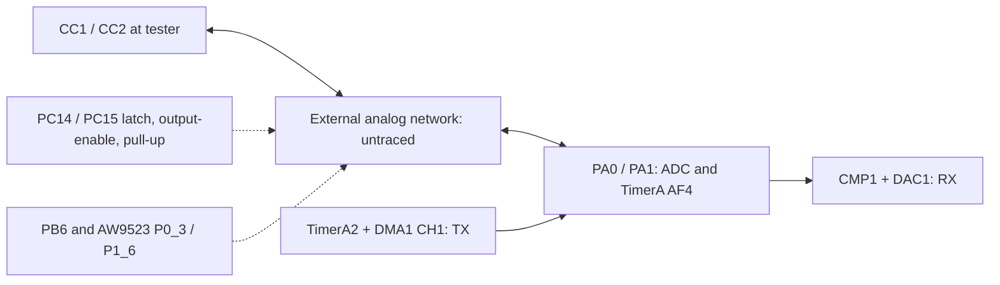

# PD transmission and usbpd integration

The installed HW2.1 **stock 2.0.7** image is the primary source for this analysis,
updated 2026-10-29. Its software encodes PD frames, uses TimerA2/DMA1 to produce
BMC transitions, and uses CMP1/DAC1/timer capture for RX. No dedicated HC32 PD
peripheral or automatic hardware GoodCRC engine has been identified. The USB FS
PHY on PA11/PA12 is a separate peripheral.

The Rust project now has an offline TX encoder and optional crates.io `usbpd`
2.0.0 decoding. **No hardware transmitter or running sink policy is enabled.**
The connected Pixel was removed before this work; all new tests are on the host.

## Verified 2.0.7 code

[Address mapping](../analysis/pd207/address-map.json) preserves the catalog 1.9.9
and installed 2.0.7 locations. These are runtime addresses. The newer control
flow and register operations were checked; matching a short byte prefix alone
was insufficient to establish a function identity.

| 2.0.7 address | Function |
| --- | --- |
| `0x9268` | Create `PD_PHY` task and initialize hardware |
| `0x934e` | Alternate RX buffers and rearm capture |
| `0x9430` | Encode a frame, switch to TX, wait and return to RX |
| `0xf86e` / `0xf976` | Select CMP input / PA0 or PA1 AF4 output |
| `0xfa8c` | Load first period and start DMA1 CH1 / TimerA2 |
| `0xfb10` | TX DMA completion: disable CH1, hold output, arm overflow IRQ |
| `0xfb46` | Select RX or TX hardware mode and overflow callback |
| `0xfbde` | Initialize timer, comparator, DAC, DMA and IRQ routing |
| `0xfff2` | Final TX timer overflow: stop timer and signal completion |
| `0x1ed58` | PHY task: decode RX, construct GoodCRC and dispatch TX/reset |
| `0x1fff8184` | RAM-resident packet-to-period encoder |

The native RX buffers are at `0x200111e8` and `0x20012866`, with **2860** halfword
intervals per capture (`0xb2c`) and metadata at byte offset `0x1658`. The older
catalog used 860. Our accepted receiver still uses 860; that covers the tested
ordinary/chunked frames and does not claim support for arbitrary long frames.

[Native C/assembly exports and provenance](../analysis/pd207/README.md) distinguish
instruction evidence from inferred decompiler types and signatures.

## TX, completion and errors

The 2.0.7 sequence is:

1. Check the object's TX-enable flag; otherwise return status 10.
2. Check CMP1 output for carrier availability (or bypass in native mode 5).
   The busy path retries three times with a delay-helper argument of 10; it
   returns status 9 if the line never becomes available. Delay units were not
   established by this analysis.
3. Encode into the current native DMA-buffer storage using the RAM encoder.
4. Disable ADC1 analog watchdog through `0x52c0(0)`.
5. Switch to TX: mask CMP edge events, stop RX timer start conditions, set
   selected PCONR.PERC=3 (invert at period), enable OUTEN and clear TX CHEN.
6. Drive selected PC14/PC15 low with its output enabled, through `0x40958`.
7. Preload PERAR=`buffer[0]`, SAR1=`buffer+1`, DMA count=`count-1`; start CH1 and
   TimerA2. Timer overflow event `0x103` supplies each following PERAR value.
8. DMA completion runs `0xfb10`: disable CH1, set PERC=2 (**hold**, not low), and
   enable the timer overflow interrupt. The last loaded interval still has to
   elapse. The vendor DDL calls these output modes `TMRA_PWM_INVT` and
   `TMRA_PWM_HOLD`.
9. The final overflow runs `0xfff2`, stops TimerA2 and signals the PHY event.
10. The waiting TX function disables timer OUTEN (`0xf9c4`), disables the selected
    PC14/PC15 output (`0x4093e`), rearms RX and enables the ADC watchdog again.

The event wait has timeout argument 5. On a nonzero wait result, status 9 is
returned, but the same output-disable/RX-rearm path still runs. The unit of this
RTOS argument is not assumed here. This caller does not explicitly quiesce TX
DMA on its timeout branch; normal DMA completion does disable it. That is not a
proof that DMA is settled after every abnormal exit.

A Rust driver must therefore wait for **wire completion**, not just DMA-done,
and must stop event producers and settle both DMA channels before recycling
memory on cancellation/failure. A dedicated TX buffer avoids the native shared
RX/TX storage arrangement. The current application owns ADC1 separately and
leaves its watchdog off: it must not blindly copy the stock unconditional
watchdog re-enable.

## Electrical controls and what remains unknown

Hardware tests establish PA0/CMP1_INP1 as CC1 and PA1/CMP1_INP2 as CC2 on this
unit. GPIO functions below are verified software controls. The diagram's analog
block is intentionally unresolved; it is not a traced schematic.



| 2.0.7 helper | Verified action |
| --- | --- |
| `0x4093e(selector)` | Disable PC14/PC15 output for selector 1/2 |
| `0x40958(selector)` | Selected PC14/PC15 latch low, output enabled |
| `0x40980(selector)` | Selected PC14/PC15 latch high, output enabled |
| `0x409a6()` | Release P0_3, set P1_6 latch high, disable both PC outputs |
| `0x40a78()` | Clear PC14/15 DDIS and output-enable; enable PB6 output |
| `0x40ab0(selector)` | Select PA0/1 AF4 and matching comparator input |
| `0x40ae0(selector)` | 1: PB6 low; 2: P0_3 high-Z; other: both |
| `0x40b12(mode)` | 0: PB6 low + P0_3 high-Z; 1: PB6 high; 2: P0_3 low; 3: PB6 high + P0_3 low |
| `0x40b58(mode)` | PC14/PC15 pull-ups: 0=off/off, 1=on/off, 2=off/on, 3=on/on |

AW9523 helper `0x1a5ae(mask,state)` changes OUTPUT0 and CONFIG0. State 0 sets the
configuration bit (input/high-Z), state 1 latches high then enables output,
other states latch low then enable output. Mask `0x08` is P0_3. `0x1a63c` changes
OUTPUT1 only: state 1 high, others low; mask `0x40` is P1_6. Its direction is not
set by that helper.

Composite helper `0x409c8(1)` enables PC14 pull-up, drives PC15 high/enabled,
latches P0_3 high/enabled **and sets PB6 high**. The older corresponding helper
lacked that PB6 write. For selector 2, it enables PC15 pull-up, drives PC14
high/enabled, latches P1_6 low and P0_3 low/enabled. These sequences are why
PC14/PC15 cannot be treated as simple independent TX-enable pins.

The firmware proves that these signals participate in CC attachment/role and
transmit behavior. It does not prove transistor topology, resistor values,
active polarity at a hidden switch, direct CC continuity, VCONN routing, or the
physical implementation of the lightning button's startup pulldown. Labeling
PB6/P0_3 as confirmed Rd controls or PC14/15 pull-ups as confirmed Rp resistors
would still go beyond this evidence. Continuity/component tracing and analog
level/impedance measurements remain necessary to finish the schematic.

## Encoding verified without the device

`pd::tx::encode` is allocation-free and writes only a caller-provided RAM slice.
It produces the native preamble, all five SOP ordered sets, low/high-nibble
4b5b data, reflected CRC-32 in wire order, EOP, and native even-halfword padding.
Hard/Cable Reset use their native shorter path without data CRC/EOP.
Length/timing/capacity failures leave output untouched. Wire chunks are limited
to a two-byte header plus up to seven four-byte data objects.

The stock RAM encoder was recovered by executing its actual scatter-load and
decompression stage in Unicorn, stopping before main. Its native CRC32 init
sets `0x40008c00=0x1e`; CRC MMIO was modeled with independent zlib CRC32. Timer,
DMA, analog circuitry, interrupts and electrical response times were not modeled.
The Rust encoder matches **162 full native reload vectors**: all SOP variants,
0..7 data objects, four payload patterns, and both reset ordered sets. The
independent RX decoder also recovers each packet/reset with CRC checks.

Native reloads are 19 and 38 at the current timer setup; these are PERAR values,
not a measurement of edge-to-edge timing. Inclusive up-counting and live reload
behavior must be accounted for and checked electrically before TX acceptance.
Matching the waveform words does not establish amplitude, impedance or timing
on CC.

```sh
uv run tools/native_pd_vectors.py --output native-pd207.tsv
cargo test --manifest-path crates/km003c-drivers/Cargo.toml --locked \
  --all-features --target x86_64-unknown-linux-gnu
```

`KM003C_STOCK_207` overrides the script's cached default input path. It refuses
any binary whose SHA-256 differs from the preserved installed 2.0.7 image.

## usbpd driver contract and next implementation step

`usbpd` **2.0.0 from crates.io** is an optional `km003c-drivers` dependency.
The offline `pd_decode` example uses it with `--features usbpd` for SOP semantic
parsing; cable-addressed SOP′/SOP″ traffic is kept distinct. This already builds
for the HC32 target as well as the host. No git fork or main dependency is used.

For a future `usbpd_traits::Driver` adapter, keep
`HAS_AUTO_GOOD_CRC=false` and `HAS_AUTO_RETRY=false`. Native task `0x1ed58` also
constructs a two-byte GoodCRC in software, then calls the normal TX function;
this is conditional on the native mode/state flags. It is not evidence of
automatic hardware acknowledgement, or a reason to acknowledge packets while
operating as a passive monitor.

The adapter needs these concrete boundaries:

- One owner for the RX/TX timer, CMP/DAC, DMA1 CH1/2, mux and frame buffers.
- `receive`: deliver only CRC-valid SOP header/data bytes, excluding PHY framing
  and CRC; surface Hard Reset. Preserve cable traffic in the monitor separately.
- `transmit`: encode into permanently owned TX storage, check carrier, switch
  RX→TX, await final timer completion, release outputs and restore RX. Every
  cancellation/error path must quiesce DMA before memory reuse.
- Fast receive/protocol work runs outside thread-mode UI/JSON formatting. Software
  GoodCRC must not depend on CDC queues or the 20 ms ADC polling interval.
- `wait_for_vbus` uses the INA229 measurement, while CC attach/termination policy
  is separately owned. Automatic receiver mux changes must not race a TX frame.
- An explicit sink device-policy manager chooses allowed requests. The crate's
  default requests 5 V at the source's maximum current; adding or running the
  stack is already active participation, not passive observation.

The published timer trait uses milliseconds, but the immediate GoodCRC send path
can start TX without awaiting a millisecond timer. Actual EOP-to-ACK delay still
needs cycle/external measurements. The measured RX rearm work is not that delay.
Do not advertise auto-GoodCRC based on the presence of timer/DMA alone.

Sources: [published driver contract](https://docs.rs/usbpd-traits/2.0.0/usbpd_traits/trait.Driver.html),
[published sink policy](https://docs.rs/usbpd/2.0.0/usbpd/sink/device_policy_manager/trait.DevicePolicyManager.html),
[upstream repository](https://github.com/elagil/usbpd). Upstream main was checked
at `b21607ad8b960da56ae801c5e42d9a86485a1f81`; its package declares 3.0.0, but
this integration deliberately uses the published 2.0.0.
